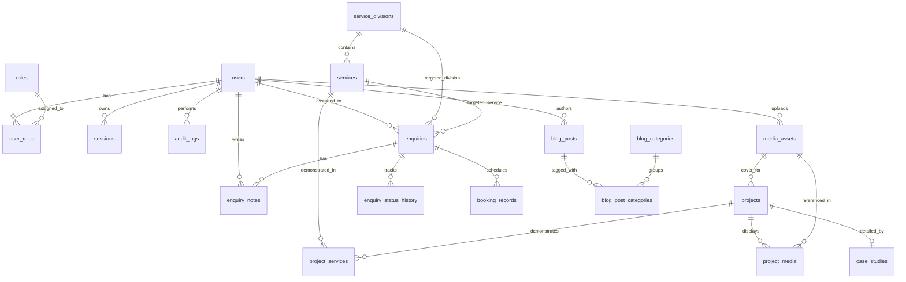

# Ediyrex Studio — PostgreSQL Database Schema Specification

**Status:** Schema Design & Gap-Filled Specification (ORM & Framework Agnostic)  
**Database Engine:** PostgreSQL 16+  
**Primary Key Strategy:** UUIDv4 / UUIDv7 (`uuid` with `gen_random_uuid()`)  
**Naming Convention:** `snake_case` for all tables, columns, enums, constraints, and indexes  
**Timestamp Standard:** `timestamptz` stored in UTC  

---

## 1. Gap Analysis: Items Filled Beyond Initial Requirements

Reviewing the Backend Schema Requirements against the PRD, TLR, and existing Frontend led to the following concrete additions and clarifications:

1. **Explicit Nullability, Deletion Policies, and Check Constraints (Section 23 Readiness)**
   - Added explicit `ON DELETE` rules for every foreign key (`RESTRICT` on published media assets and active divisions, `SET NULL` on optional admin assignments and audit actors, `CASCADE` on join tables and child notes/history).
   - Added `CHECK` constraints for `budget_min <= budget_max`, non-negative `file_size`, `display_order >= 0`, valid slug format, and non-self-referencing `navigation_items.parent_id <> id`.
2. **Missing Columns Discovered in Core Entities**
   - `projects`: Added `display_order` (required by *"reorder projects"*), `is_concept` / `project_type` enum (`client | concept | internal`), `cover_asset_id` (`ON DELETE RESTRICT`), and `client_is_public` safety flag.
   - `case_studies`: Added `UNIQUE (project_id)` to enforce 1:1 relation and `status` (`publication_status`) so a project can exist independently of a published case study.
   - `services`: Added `icon_name` (matching frontend service cards) and typed `deliverables` as `jsonb` array (`[]`) with explicit structure.
   - `enquiries`: Added `service_id` (nullable FK to `services`, matching `/contact?service=<slug>`), `dedupe_hash` (prevent duplicate accidental form submissions), and `ip_hash` (privacy-safe hashed client IP for rate-limit/spam auditing without storing raw IP PII).
   - `notification_outbox`: Added `dedupe_key` (`UNIQUE` partial index), `max_attempts`, and `locked_at` to support safe concurrent worker polling (`FOR UPDATE SKIP LOCKED`) without duplicate emails.
   - `audit_logs`: Added `actor_email_snapshot` so audit records remain legible if an admin user is ever removed (`ON DELETE SET NULL`).
   - `media_assets`: Added `archived_at` soft-archive column so assets tied to published projects are archived rather than hard-deleted.
3. **Hybrid Model Support (`studio_products`)**
   - Added a dedicated Phase 4/5 optional table `studio_products` to represent Ediyrex's proprietary in-house products (e.g., *AgentCore*, *Vocalis*, *RenderFlow*) cleanly without overloading client portfolio `projects`.
4. **Automatic `updated_at` Trigger**
   - Added a reusable PostgreSQL `set_updated_at()` trigger function for every mutable table.

---

## 2. Shared Extensions & Enum Types

```sql
CREATE EXTENSION IF NOT EXISTS "pgcrypto";

-- Shared publication lifecycle
CREATE TYPE publication_status AS ENUM ('draft', 'published', 'archived');

-- User account lifecycle
CREATE TYPE account_status AS ENUM ('invited', 'active', 'disabled');

-- Portfolio project classification
CREATE TYPE project_type AS ENUM ('client', 'concept', 'internal');

-- Project media roles
CREATE TYPE project_media_role AS ENUM ('cover', 'gallery', 'video_preview', 'diagram');

-- Media asset classification
CREATE TYPE media_resource_type AS ENUM ('image', 'video', 'document');

-- Enquiry / CRM pipeline statuses
CREATE TYPE enquiry_status AS ENUM (
  'new',
  'reviewing',
  'qualified',
  'proposal_sent',
  'won',
  'lost',
  'archived'
);

-- Reliable outbox processing statuses
CREATE TYPE outbox_status AS ENUM (
  'pending',
  'processing',
  'sent',
  'failed',
  'dead_letter'
);

-- Navigation menu placement
CREATE TYPE navigation_location AS ENUM ('header', 'footer_primary', 'footer_legal');

-- Shared updated_at trigger function
CREATE OR REPLACE FUNCTION set_updated_at()
RETURNS TRIGGER AS $$
BEGIN
  NEW.updated_at = NOW();
  RETURN NEW;
END;
$$ LANGUAGE plpgsql;
```

---

## 3. Entity Relationship Overview



---

## 4. Schema Definitions by Implementation Phase

### Phase 1: Core Website (Divisions, Services, Media, Portfolio)

#### `media_assets` (Defined early because `projects`, `testimonials`, and `blog_posts` reference it)
```sql
CREATE TABLE media_assets (
  id                  uuid PRIMARY KEY DEFAULT gen_random_uuid(),
  storage_provider    varchar(32) NOT NULL DEFAULT 'cloudinary', -- e.g. 'cloudinary', 'local'
  provider_asset_id   varchar(255) NOT NULL,
  provider_public_id  varchar(255),
  asset_url           text NOT NULL,
  secure_url          text NOT NULL,
  resource_type       media_resource_type NOT NULL,
  mime_type           varchar(128) NOT NULL,
  file_size_bytes     bigint NOT NULL CHECK (file_size_bytes > 0),
  width               integer CHECK (width IS NULL OR width > 0),
  height              integer CHECK (height IS NULL OR height > 0),
  alt_text            varchar(300) NOT NULL DEFAULT '',
  caption             text,
  provider_metadata   jsonb NOT NULL DEFAULT '{}'::jsonb, -- Allowlisted keys only (format, duration)
  uploaded_by_user_id uuid, -- FK added after users table or nullable
  archived_at         timestamptz,
  created_at          timestamptz NOT NULL DEFAULT NOW(),

  UNIQUE (storage_provider, provider_asset_id)
);

CREATE INDEX idx_media_assets_resource_type ON media_assets (resource_type) WHERE archived_at IS NULL;
```

#### `service_divisions`
```sql
CREATE TABLE service_divisions (
  id            uuid PRIMARY KEY DEFAULT gen_random_uuid(),
  name          varchar(80) NOT NULL,
  slug          varchar(80) NOT NULL UNIQUE,
  description   text NOT NULL,
  icon_name     varchar(64),
  display_order integer NOT NULL DEFAULT 0 CHECK (display_order >= 0),
  is_active     boolean NOT NULL DEFAULT true,
  created_at    timestamptz NOT NULL DEFAULT NOW(),
  updated_at    timestamptz NOT NULL DEFAULT NOW()
);

CREATE TRIGGER trg_service_divisions_updated_at
  BEFORE UPDATE ON service_divisions FOR EACH ROW EXECUTE FUNCTION set_updated_at();
```

#### `services`
```sql
CREATE TABLE services (
  id               uuid PRIMARY KEY DEFAULT gen_random_uuid(),
  division_id      uuid NOT NULL REFERENCES service_divisions(id) ON DELETE RESTRICT,
  title            varchar(140) NOT NULL,
  slug             varchar(140) NOT NULL UNIQUE,
  summary          varchar(320) NOT NULL,
  description      text NOT NULL,
  deliverables     jsonb NOT NULL DEFAULT '[]'::jsonb, -- Array of short deliverable strings
  icon_name        varchar(64),
  is_featured      boolean NOT NULL DEFAULT false,
  display_order    integer NOT NULL DEFAULT 0 CHECK (display_order >= 0),
  status           publication_status NOT NULL DEFAULT 'draft',
  seo_title        varchar(160),
  seo_description  varchar(320),
  published_at     timestamptz,
  created_at       timestamptz NOT NULL DEFAULT NOW(),
  updated_at       timestamptz NOT NULL DEFAULT NOW()
);

CREATE INDEX idx_services_division_published ON services (division_id, display_order)
  WHERE status = 'published';
CREATE INDEX idx_services_featured ON services (display_order)
  WHERE status = 'published' AND is_featured = true;

CREATE TRIGGER trg_services_updated_at
  BEFORE UPDATE ON services FOR EACH ROW EXECUTE FUNCTION set_updated_at();
```

#### `projects`
```sql
CREATE TABLE projects (
  id                uuid PRIMARY KEY DEFAULT gen_random_uuid(),
  title             varchar(180) NOT NULL,
  slug              varchar(180) NOT NULL UNIQUE,
  summary           varchar(400) NOT NULL,
  description       text NOT NULL,
  project_type      project_type NOT NULL DEFAULT 'concept', -- 'client' | 'concept' | 'internal'
  industry          varchar(100),
  client_name       varchar(140), -- Only populated when authorized
  client_is_public  boolean NOT NULL DEFAULT false,
  cover_asset_id    uuid REFERENCES media_assets(id) ON DELETE RESTRICT,
  live_url          text,
  repository_url    text,
  is_featured       boolean NOT NULL DEFAULT false,
  display_order     integer NOT NULL DEFAULT 0 CHECK (display_order >= 0),
  status            publication_status NOT NULL DEFAULT 'draft',
  seo_title         varchar(160),
  seo_description   varchar(320),
  published_at      timestamptz,
  created_at        timestamptz NOT NULL DEFAULT NOW(),
  updated_at        timestamptz NOT NULL DEFAULT NOW(),

  -- Invariant: concept/internal projects cannot falsely declare a public client name
  CONSTRAINT chk_project_client_honesty CHECK (
    (project_type = 'client') OR (client_name IS NULL AND client_is_public = false)
  )
);

CREATE INDEX idx_projects_published_order ON projects (display_order, published_at DESC)
  WHERE status = 'published';
CREATE INDEX idx_projects_type_published ON projects (project_type)
  WHERE status = 'published';

CREATE TRIGGER trg_projects_updated_at
  BEFORE UPDATE ON projects FOR EACH ROW EXECUTE FUNCTION set_updated_at();
```

#### `project_services`
```sql
CREATE TABLE project_services (
  project_id uuid NOT NULL REFERENCES projects(id) ON DELETE CASCADE,
  service_id uuid NOT NULL REFERENCES services(id) ON DELETE RESTRICT,
  PRIMARY KEY (project_id, service_id)
);

CREATE INDEX idx_project_services_service_id ON project_services (service_id);
```

#### `case_studies`
```sql
CREATE TABLE case_studies (
  id                uuid PRIMARY KEY DEFAULT gen_random_uuid(),
  project_id        uuid NOT NULL UNIQUE REFERENCES projects(id) ON DELETE CASCADE,
  challenge         text NOT NULL,
  approach          text NOT NULL,
  solution          text NOT NULL,
  verified_outcomes jsonb NOT NULL DEFAULT '[]'::jsonb, -- Array of verified outcomes/deliverables
  process_steps     jsonb NOT NULL DEFAULT '[]'::jsonb, -- Array of { title, description }
  status            publication_status NOT NULL DEFAULT 'draft',
  published_at      timestamptz,
  created_at        timestamptz NOT NULL DEFAULT NOW(),
  updated_at        timestamptz NOT NULL DEFAULT NOW()
);

CREATE TRIGGER trg_case_studies_updated_at
  BEFORE UPDATE ON case_studies FOR EACH ROW EXECUTE FUNCTION set_updated_at();
```

#### `project_media`
```sql
CREATE TABLE project_media (
  project_id     uuid NOT NULL REFERENCES projects(id) ON DELETE CASCADE,
  media_asset_id uuid NOT NULL REFERENCES media_assets(id) ON DELETE RESTRICT,
  media_role     project_media_role NOT NULL DEFAULT 'gallery',
  display_order  integer NOT NULL DEFAULT 0 CHECK (display_order >= 0),
  PRIMARY KEY (project_id, media_asset_id)
);

CREATE INDEX idx_project_media_order ON project_media (project_id, display_order);
```

---

### Phase 2: Lead Generation & Reliable Outbox

#### `enquiries`
```sql
CREATE TABLE enquiries (
  id                       uuid PRIMARY KEY DEFAULT gen_random_uuid(),
  reference_code           varchar(24) NOT NULL UNIQUE, -- e.g. 'ENQ-2026-0042'
  contact_name             varchar(120) NOT NULL,
  email_normalized         varchar(255) NOT NULL,
  company_name             varchar(140),
  phone                    varchar(40),
  service_division_id      uuid REFERENCES service_divisions(id) ON DELETE SET NULL,
  service_id               uuid REFERENCES services(id) ON DELETE SET NULL,
  project_type             varchar(140) NOT NULL,
  goals_and_requirements   text NOT NULL,
  budget_min               integer CHECK (budget_min IS NULL OR budget_min >= 0),
  budget_max               integer CHECK (budget_max IS NULL OR budget_max >= 0),
  budget_currency          char(3) CHECK (budget_currency IS NULL OR budget_currency ~ '^[A-Z]{3}$'),
  expected_timeline        varchar(64) NOT NULL,
  status                   enquiry_status NOT NULL DEFAULT 'new',
  source                   varchar(64) NOT NULL DEFAULT 'website_contact_form',
  wants_discovery_call     boolean NOT NULL DEFAULT false,
  consent_at               timestamptz NOT NULL,
  privacy_notice_version   varchar(32) NOT NULL DEFAULT 'v1.0',
  assigned_admin_user_id   uuid, -- FK to users(id) ON DELETE SET NULL
  dedupe_hash              varchar(64), -- Prevents double-click duplicate submissions within short window
  ip_hash                  varchar(64), -- Hashed IP for abuse detection (no raw IP PII)
  submitted_at             timestamptz NOT NULL DEFAULT NOW(),
  updated_at               timestamptz NOT NULL DEFAULT NOW(),
  archived_at              timestamptz,

  CONSTRAINT chk_budget_range_valid CHECK (
    budget_min IS NULL OR budget_max IS NULL OR budget_min <= budget_max
  ),
  CONSTRAINT chk_budget_currency_required CHECK (
    (budget_min IS NULL AND budget_max IS NULL) OR budget_currency IS NOT NULL
  )
);

CREATE INDEX idx_enquiries_status_submitted ON enquiries (status, submitted_at DESC);
CREATE INDEX idx_enquiries_assigned_admin ON enquiries (assigned_admin_user_id)
  WHERE assigned_admin_user_id IS NOT NULL;
CREATE INDEX idx_enquiries_email ON enquiries (email_normalized);
CREATE INDEX idx_enquiries_dedupe_hash ON enquiries (dedupe_hash, submitted_at DESC)
  WHERE dedupe_hash IS NOT NULL;

CREATE TRIGGER trg_enquiries_updated_at
  BEFORE UPDATE ON enquiries FOR EACH ROW EXECUTE FUNCTION set_updated_at();
```

#### `enquiry_notes`
```sql
CREATE TABLE enquiry_notes (
  id              uuid PRIMARY KEY DEFAULT gen_random_uuid(),
  enquiry_id      uuid NOT NULL REFERENCES enquiries(id) ON DELETE CASCADE,
  author_user_id  uuid, -- FK to users(id) ON DELETE SET NULL
  body            text NOT NULL,
  created_at      timestamptz NOT NULL DEFAULT NOW(),
  updated_at      timestamptz NOT NULL DEFAULT NOW()
);

CREATE INDEX idx_enquiry_notes_enquiry ON enquiry_notes (enquiry_id, created_at DESC);

CREATE TRIGGER trg_enquiry_notes_updated_at
  BEFORE UPDATE ON enquiry_notes FOR EACH ROW EXECUTE FUNCTION set_updated_at();
```

#### `enquiry_status_history`
```sql
CREATE TABLE enquiry_status_history (
  id              uuid PRIMARY KEY DEFAULT gen_random_uuid(),
  enquiry_id      uuid NOT NULL REFERENCES enquiries(id) ON DELETE CASCADE,
  changed_by_id   uuid, -- FK to users(id) ON DELETE SET NULL
  previous_status enquiry_status,
  new_status      enquiry_status NOT NULL,
  reason          varchar(320),
  created_at      timestamptz NOT NULL DEFAULT NOW()
);

CREATE INDEX idx_enquiry_status_history_enquiry ON enquiry_status_history (enquiry_id, created_at DESC);
```

#### `notification_outbox`
```sql
CREATE TABLE notification_outbox (
  id            uuid PRIMARY KEY DEFAULT gen_random_uuid(),
  event_type    varchar(80) NOT NULL, -- e.g. 'enquiry.submitted.studio_alert'
  entity_type   varchar(64) NOT NULL, -- e.g. 'enquiry'
  entity_id     uuid NOT NULL,
  dedupe_key    varchar(160) UNIQUE,  -- Prevents duplicate queuing
  payload       jsonb NOT NULL DEFAULT '{}'::jsonb, -- Minimal payload; never store secrets
  status        outbox_status NOT NULL DEFAULT 'pending',
  attempt_count integer NOT NULL DEFAULT 0 CHECK (attempt_count >= 0),
  max_attempts  integer NOT NULL DEFAULT 5 CHECK (max_attempts > 0),
  next_retry_at timestamptz NOT NULL DEFAULT NOW(),
  locked_at     timestamptz,
  last_error    varchar(255), -- Sanitized error code/summary only
  created_at    timestamptz NOT NULL DEFAULT NOW(),
  delivered_at  timestamptz
);

CREATE INDEX idx_outbox_pending_poll ON notification_outbox (next_retry_at)
  WHERE status IN ('pending', 'failed');
```

---

### Phase 3: Authentication, RBAC & Audit Logging

#### `users`
```sql
CREATE TABLE users (
  id                uuid PRIMARY KEY DEFAULT gen_random_uuid(),
  email_normalized  varchar(255) NOT NULL UNIQUE,
  display_name      varchar(120) NOT NULL,
  password_hash     text, -- Nullable if delegated to external SSO/provider
  status            account_status NOT NULL DEFAULT 'invited',
  email_verified_at timestamptz,
  last_login_at     timestamptz,
  created_at        timestamptz NOT NULL DEFAULT NOW(),
  updated_at        timestamptz NOT NULL DEFAULT NOW()
);

CREATE TRIGGER trg_users_updated_at
  BEFORE UPDATE ON users FOR EACH ROW EXECUTE FUNCTION set_updated_at();
```

#### `roles` & `user_roles`
```sql
CREATE TABLE roles (
  id          uuid PRIMARY KEY DEFAULT gen_random_uuid(),
  name        varchar(64) NOT NULL UNIQUE, -- e.g. 'super_admin', 'editor', 'sales_lead'
  description varchar(255) NOT NULL DEFAULT '',
  created_at  timestamptz NOT NULL DEFAULT NOW()
);

CREATE TABLE user_roles (
  user_id    uuid NOT NULL REFERENCES users(id) ON DELETE CASCADE,
  role_id    uuid NOT NULL REFERENCES roles(id) ON DELETE CASCADE,
  created_at timestamptz NOT NULL DEFAULT NOW(),
  PRIMARY KEY (user_id, role_id)
);
```

#### `sessions`
```sql
CREATE TABLE sessions (
  id          uuid PRIMARY KEY DEFAULT gen_random_uuid(),
  user_id     uuid NOT NULL REFERENCES users(id) ON DELETE CASCADE,
  token_hash  varchar(128) NOT NULL UNIQUE, -- SHA-256 / HMAC hash of opaque session cookie
  expires_at  timestamptz NOT NULL,
  revoked_at  timestamptz,
  created_at  timestamptz NOT NULL DEFAULT NOW()
);

CREATE INDEX idx_sessions_user_active ON sessions (user_id, expires_at)
  WHERE revoked_at IS NULL;
```

#### `audit_logs`
```sql
CREATE TABLE audit_logs (
  id                   uuid PRIMARY KEY DEFAULT gen_random_uuid(),
  actor_user_id        uuid REFERENCES users(id) ON DELETE SET NULL,
  actor_email_snapshot varchar(255), -- Preserves accountability if user deleted
  action               varchar(80) NOT NULL, -- e.g. 'project.published', 'enquiry.status_changed'
  entity_type          varchar(64) NOT NULL,
  entity_id            uuid,
  metadata             jsonb NOT NULL DEFAULT '{}'::jsonb, -- Minimal diff/summary; no PII or secrets
  created_at           timestamptz NOT NULL DEFAULT NOW()
);

CREATE INDEX idx_audit_logs_entity ON audit_logs (entity_type, entity_id, created_at DESC);
CREATE INDEX idx_audit_logs_actor ON audit_logs (actor_user_id, created_at DESC);
```

> **Cross-Phase FKs to enforce in Phase 3 Migration:**  
> Add foreign keys from `media_assets.uploaded_by_user_id`, `enquiries.assigned_admin_user_id`, `enquiry_notes.author_user_id`, and `enquiry_status_history.changed_by_id` referencing `users(id) ON DELETE SET NULL`.

---

### Phase 4: Extended Content, Settings, Navigation & Scheduling

#### `testimonials`
```sql
CREATE TABLE testimonials (
  id                  uuid PRIMARY KEY DEFAULT gen_random_uuid(),
  author_display_name varchar(120) NOT NULL,
  author_role         varchar(120),
  company_name        varchar(140),
  content             text NOT NULL,
  media_asset_id      uuid REFERENCES media_assets(id) ON DELETE SET NULL,
  source_url          text,
  consent_verified_at timestamptz NOT NULL, -- Mandatory: never publish without explicit consent
  status              publication_status NOT NULL DEFAULT 'draft',
  display_order       integer NOT NULL DEFAULT 0 CHECK (display_order >= 0),
  published_at        timestamptz,
  created_at          timestamptz NOT NULL DEFAULT NOW(),
  updated_at          timestamptz NOT NULL DEFAULT NOW()
);

CREATE INDEX idx_testimonials_published ON testimonials (display_order)
  WHERE status = 'published';

CREATE TRIGGER trg_testimonials_updated_at
  BEFORE UPDATE ON testimonials FOR EACH ROW EXECUTE FUNCTION set_updated_at();
```

#### `blog_categories`, `blog_posts`, & `blog_post_categories`
```sql
CREATE TABLE blog_categories (
  id          uuid PRIMARY KEY DEFAULT gen_random_uuid(),
  name        varchar(80) NOT NULL,
  slug        varchar(80) NOT NULL UNIQUE,
  description text,
  created_at  timestamptz NOT NULL DEFAULT NOW()
);

CREATE TABLE blog_posts (
  id              uuid PRIMARY KEY DEFAULT gen_random_uuid(),
  author_user_id  uuid REFERENCES users(id) ON DELETE SET NULL,
  title           varchar(200) NOT NULL,
  slug            varchar(200) NOT NULL UNIQUE,
  excerpt         varchar(400) NOT NULL,
  body_markdown   text NOT NULL,
  cover_asset_id  uuid REFERENCES media_assets(id) ON DELETE RESTRICT,
  status          publication_status NOT NULL DEFAULT 'draft',
  seo_title       varchar(160),
  seo_description varchar(320),
  canonical_url   text,
  published_at    timestamptz,
  created_at      timestamptz NOT NULL DEFAULT NOW(),
  updated_at      timestamptz NOT NULL DEFAULT NOW()
);

CREATE INDEX idx_blog_posts_published ON blog_posts (published_at DESC)
  WHERE status = 'published';

CREATE TRIGGER trg_blog_posts_updated_at
  BEFORE UPDATE ON blog_posts FOR EACH ROW EXECUTE FUNCTION set_updated_at();

CREATE TABLE blog_post_categories (
  blog_post_id uuid NOT NULL REFERENCES blog_posts(id) ON DELETE CASCADE,
  category_id  uuid NOT NULL REFERENCES blog_categories(id) ON DELETE CASCADE,
  PRIMARY KEY (blog_post_id, category_id)
);
```

#### `site_settings` & `navigation_items`
```sql
CREATE TABLE site_settings (
  id                 uuid PRIMARY KEY DEFAULT gen_random_uuid(),
  setting_key        varchar(100) NOT NULL UNIQUE, -- e.g. 'contact_email', 'default_seo'
  setting_value      jsonb NOT NULL DEFAULT '{}'::jsonb,
  description        varchar(255),
  is_public          boolean NOT NULL DEFAULT false, -- Controls exposure on public config API
  updated_by_user_id uuid REFERENCES users(id) ON DELETE SET NULL,
  updated_at         timestamptz NOT NULL DEFAULT NOW()
);

CREATE TRIGGER trg_site_settings_updated_at
  BEFORE UPDATE ON site_settings FOR EACH ROW EXECUTE FUNCTION set_updated_at();

CREATE TABLE navigation_items (
  id               uuid PRIMARY KEY DEFAULT gen_random_uuid(),
  label            varchar(64) NOT NULL,
  destination      varchar(500) NOT NULL,
  is_external      boolean NOT NULL DEFAULT false,
  location         navigation_location NOT NULL,
  parent_id        uuid REFERENCES navigation_items(id) ON DELETE CASCADE,
  display_order    integer NOT NULL DEFAULT 0 CHECK (display_order >= 0),
  is_active        boolean NOT NULL DEFAULT true,
  created_at       timestamptz NOT NULL DEFAULT NOW(),
  updated_at       timestamptz NOT NULL DEFAULT NOW(),

  CONSTRAINT chk_nav_no_self_parent CHECK (parent_id IS NULL OR parent_id <> id)
);

CREATE INDEX idx_navigation_location_active ON navigation_items (location, display_order)
  WHERE is_active = true;

CREATE TRIGGER trg_navigation_items_updated_at
  BEFORE UPDATE ON navigation_items FOR EACH ROW EXECUTE FUNCTION set_updated_at();
```

#### `booking_records` (External Calendar Webhook Sync)
```sql
CREATE TABLE booking_records (
  id                  uuid PRIMARY KEY DEFAULT gen_random_uuid(),
  provider            varchar(40) NOT NULL, -- e.g. 'cal_com', 'calendly'
  provider_booking_id varchar(160) NOT NULL,
  enquiry_id          uuid REFERENCES enquiries(id) ON DELETE SET NULL,
  booking_status      varchar(40) NOT NULL, -- 'scheduled', 'rescheduled', 'cancelled', 'completed'
  starts_at           timestamptz NOT NULL,
  ends_at             timestamptz NOT NULL,
  provider_metadata   jsonb NOT NULL DEFAULT '{}'::jsonb,
  created_at          timestamptz NOT NULL DEFAULT NOW(),
  updated_at          timestamptz NOT NULL DEFAULT NOW(),

  UNIQUE (provider, provider_booking_id),
  CONSTRAINT chk_booking_time_valid CHECK (ends_at > starts_at)
);

CREATE INDEX idx_booking_records_enquiry ON booking_records (enquiry_id)
  WHERE enquiry_id IS NOT NULL;

CREATE TRIGGER trg_booking_records_updated_at
  BEFORE UPDATE ON booking_records FOR EACH ROW EXECUTE FUNCTION set_updated_at();
```

---

### Phase 5: Studio Ventures & Future AI Modules (Deferred Until Approved)

#### `studio_products` (Supports Ediyrex's Hybrid Venture Model)
```sql
-- Introduce when in-house SaaS / venture products are managed dynamically
CREATE TABLE studio_products (
  id              uuid PRIMARY KEY DEFAULT gen_random_uuid(),
  division_id     uuid REFERENCES service_divisions(id) ON DELETE SET NULL,
  name            varchar(140) NOT NULL,
  slug            varchar(140) NOT NULL UNIQUE,
  tagline         varchar(240) NOT NULL,
  description     text NOT NULL,
  product_stage   varchar(32) NOT NULL CHECK (product_stage IN ('research', 'alpha', 'beta', 'live')),
  tech_stack      jsonb NOT NULL DEFAULT '[]'::jsonb,
  demo_url        text,
  status          publication_status NOT NULL DEFAULT 'draft',
  display_order   integer NOT NULL DEFAULT 0 CHECK (display_order >= 0),
  created_at      timestamptz NOT NULL DEFAULT NOW(),
  updated_at      timestamptz NOT NULL DEFAULT NOW()
);
```

*(Future AI tables — `agent_definitions`, `automation_workflows`, `workflow_runs`, `knowledge_documents`, `knowledge_chunks`, and `integration_connections` — remain deferred until specific AI product endpoints are approved.)*

---

## 5. Transaction & Security Boundaries

1. **Enquiry Intake Transaction**:
   - Insert into `enquiries` -> Insert initial `'new'` row into `enquiry_status_history` -> Insert alert event into `notification_outbox` with `dedupe_key` **inside one PostgreSQL transaction**.
2. **Enquiry Status Change Transaction**:
   - Update `enquiries.status` -> Insert into `enquiry_status_history` -> Insert into `audit_logs` **inside one transaction**.
3. **Public API Projection Rules**:
   - Public endpoints (`/api/v1/services`, `/api/v1/projects`, `/api/v1/projects/:slug`, public settings) **must filter** `status = 'published'` and project only public columns (never exposing `ip_hash`, `dedupe_hash`, `users`, `audit_logs`, or `site_settings` where `is_public = false`).
4. **Media Deletion Protection**:
   - Never hard-delete a `media_assets` row referenced by a published project or blog post (`ON DELETE RESTRICT` enforces this at the DB level; set `archived_at` instead).

